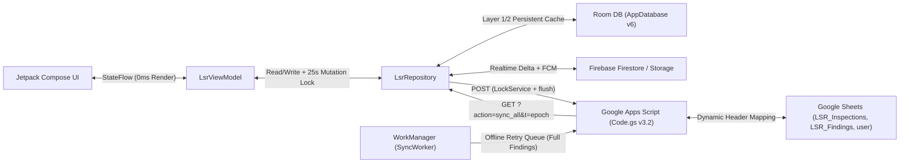

# Blueprint Arsitektur & Integrasi Google Apps Script (GAS v3.2)

Dokumen ini menjadi **panduan arsitektur resmi** untuk integrasi **Google Apps Script + Google Sheets** di **HSE LSR Inspector**. Blueprint ini mengadopsi standar konkurensi, anti-race-condition, anti-formula-injection, autentikasi user sheet terpusat, proteksi `APP_API_TOKEN`, serta sinkronisasi instan dua arah (*Stale-While-Revalidate*).

---

## 1. Arsitektur Dual-Backend (Zero-Latency + Atomic Sheets)

**Komponen Kunci:**
- **Server (`Code.gs` & `GoogleAppsScriptSnippet.kt`)**: Webhook Apps Script **v3.2** yang melayani `doGet(e)` (pull data) dan `doPost(e)` (push inspeksi, upsert status temuan, serta auth tab `user`).
- **Client Repository (`LsrRepository.kt`)**: Mengelola `OkHttpClient` dengan `followRedirects = true`, anti-cache `?t=<epochMs>`, *optimistic write* ke Room, serta **25-second Mutation Lock** (`pendingLocalMutations`).
- **Sync Orchestrator (`LsrViewModel.kt`, `LsrInspectionApp.kt`, & `SyncWorker.kt`)**: Menjalankan `silentBackgroundSync()` saat startup, saat kembali ke layar (`Lifecycle.Event.ON_RESUME`), *silent polling* tiap **20 detik** dengan *exponential backoff* (`20s -> 40s -> 80s -> 180s`), serta retry offline via `SyncWorker` yang merekonstruksi `findings` lengkap dari Room.

---

## 2. Pengamanan Konkurensi & Integritas Google Sheets (`Code.gs` v3.2)

| Safeguard | Implementasi di `Code.gs` | Masalah yang Dicegah |
| :--- | :--- | :--- |
| **Script Lock 25s** | `LockService.getScriptLock().tryLock(25000)` + `finally { lock.releaseLock() }` pada `doPost` | Menimpa baris (*row collision*) saat beberapa inspektur/PIC mengirim data bersamaan. |
| **Atomic Flush** | `SpreadsheetApp.flush()` sebelum merespons JSON | Memaksa penulisan selesai ke disk Sheets sebelum client melakukan `doGet` berikutnya. |
| **Dynamic Header Mapping** | `getHeaderMapFromRow()`, `getColValue()`, `setCellByHeader()`, `appendRowByHeaders()` | Mencegah data berantakan jika admin menggeser atau menambah kolom di Google Sheets. |
| **Anti-Formula Injection** | `sanitizeSheetText()` (prefix `'=` / `'+` / `'-` / `'@` / `'\t` / `'\r`) & `unsanitizeText()` saat read | Melindungi spreadsheet admin dari payload berbahaya yang diawali karakter formula Excel/Sheets. |
| **Optional App Token Guard** | `getConfiguredAppToken()` & `validateRequestToken()` (`PropertiesService.getScriptProperties()`) | Memblokir request pihak luar jika admin mengaktifkan `APP_API_TOKEN` pada Script Properties. |
| **Password Non-Overwrite** | `upsertUserInSheet()` hanya memperbarui `name`, `role`, `company`, `uid`, `updated_at` | Mencegah sinkronisasi profil (`sync_user`/`upsert_user`) menimpa kata sandi pengguna yang sudah ada. |
| **Anti-Duplikasi & Upsert** | `hasInspectionSignature()` & `upsertFindingRow()` berbasis `Finding Key` (`timestamp_ruleId_area`) | Mencegah baris inspeksi ganda saat retry jaringan dan melakukan update status temuan *in-place*. |
| **Identity & Status Normalization** | `isSamePersonServer()` & `normalizeStatusServer()` | Menyeragamkan identitas (`"Budi (HSE)"` == `"budi"`) dan status (`IN_REVIEW`, `ACTION_SUBMITTED`, `OPEN`, `CLOSED`, `REOPENED`). |

---

## 3. Ketahanan Klien: Mutation Lock 25 Detik & Anti-Cache

### A. Mengapa Perlu 25-Second Mutation Lock (`pendingLocalMutations`)?
Saat user mengubah status temuan (assign PIC, submit perbaikan, verifikasi tutup, atau reopen), UI langsung diperbarui di Room (*optimistic UI*) sementara `WorkManager` / `pushFindingUpdateToGas` menulis ke Google Sheets. Jika polling latar belakang (`pullFromGasWebhook`) berjalan 2 detik kemudian dan Sheets belum selesai menulis, data lama dari server bisa menimpa perubahan lokal (*state flicker*).

Solusi di [`LsrRepository.kt`](file:///Users/rullyberiandi/StudioProjects/LSR/app/src/main/java/com/example/data/LsrRepository.kt):
- Setiap mutasi lokal memanggil `markLocalFindingMutation(timestamp, ruleId, area)` dengan kunci ter-normalisasi `"${timestamp}_${ruleId.lowercase()}_${area.lowercase()}"`.
- Selama **25.000 ms** (`MUTATION_LOCK_DURATION_MS`), `pullFromGasWebhook` mengecek `isMutationLocked(ts, ruleId, areaVal)` dan **melewati penimpaan** untuk temuan yang sedang dikunci.

### B. Aturan Jaringan Google Apps Script (Wajib Dipatuhi)
1. **Tanpa Custom Header pada `GET`**: Jangan mengirim header custom (seperti `Cache-Control` atau `Authorization` tambahan) pada `doGet`, karena memicu kegagalan preflight/redirect pada endpoint `/exec`.
2. **Cache-Busting `?t=`**: Selalu sertakan `&t=${System.currentTimeMillis()}` pada URL `doGet` (`action=sync_all` & `action=ping`) agar CDN Google tidak mengembalikan respons cache lama.
3. **Follow Redirects**: `OkHttpClient` wajib mengaktifkan `.followRedirects(true)` dan `.followSslRedirects(true)` karena Apps Script selalu merespons dengan `302 Moved Temporarily` menuju `script.googleusercontent.com`.

---

## 4. Skema Sheet (`LSR_Inspections`, `LSR_Findings`, dan `user`)

- **`LSR_Inspections`** *(fallback baca otomatis ke legacy `Inspeksi_LSR` jika sheet baru belum terisi)*:
  `Timestamp (ISO)` | `Timestamp (ms)` | `Inspection ID` | `Inspector Name` | `Company` | `Area / Location` | `Compliance Score (%)` | `LSR Categories` | `Total Rules` | `YES` | `NO` | `NA` | `Raw Answers JSON`
- **`LSR_Findings`**:
  `Timestamp (ISO)` | `Timestamp (ms)` | `Finding Key` | `Inspection ID` | `Inspector Name` | `Company` | `Area / Location` | `Rule ID` | `Category` | `Violation Question` | `Standard Reference` | `Severity` | `PIC Name` | `PIC Email` | `Observation Notes` | `Corrective Action` | `Status` | `Rating` | `Updated At (ms)`
- **`user`** *(manajemen user terpusat untuk Login, Register, Role, & PIC Roster)*:
  `name` | `email` | `role` | `company` | `password` | `uid` | `created_at` | `updated_at`
  - **Keamanan Password**: Registrasi dari aplikasi otomatis meng-hash password (`sha256:...`), sedangkan admin tetap bisa mengetik password langsung di Google Sheets untuk akun baru. Kolom `password` **tidak pernah** dikirim di `doGet` (`?action=sync_all` / `?action=users`), **tidak pernah ditimpa** oleh `upsertUserInSheet` untuk user yang sudah ada, dan verifikasi password hanya dilakukan di server via `doPost` (`action=login_user`).
  - **Opsional Token API (`APP_API_TOKEN`)**: Untuk keamanan ekstra, set Script Property `APP_API_TOKEN` di **Project Settings -> Script Properties** Apps Script, lalu tambahkan `?token=<token_anda>` di belakang URL `/exec` saat admin menyimpannya di aplikasi.
  - **Auto-Setup**: Jalankan fungsi `setupSheets()` di Apps Script editor (`Run -> setupSheets`) atau panggil `?action=setup` untuk membuat ketiga tab sheet beserta header-nya secara otomatis.

---

## 5. Aturan Ekstensi untuk Developer & AI Agent

1. **Sinkronisasi Ganda `Code.gs` & `GoogleAppsScriptSnippet.kt`**:
   Setiap perubahan di [`Code.gs`](file:///Users/rullyberiandi/StudioProjects/LSR/Code.gs) **wajib** disalin identik ke `GoogleAppsScriptSnippet.CODE_GS` di [`GoogleAppsScriptSnippet.kt`](file:///Users/rullyberiandi/StudioProjects/LSR/app/src/main/java/com/example/data/GoogleAppsScriptSnippet.kt) dan diverifikasi oleh [`ScaleFeaturesUnitTest.kt`](file:///Users/rullyberiandi/StudioProjects/LSR/app/src/test/java/com/example/ScaleFeaturesUnitTest.kt).
2. **Jangan Hapus `sanitizeSheetText()` atau `LockService`**:
   Penambahan action `doPost` baru wajib berada di dalam blok `lock.tryLock(25000)` + `SpreadsheetApp.flush()` + `finally { lock.releaseLock() }`.
3. **Kompresi Foto Sebelum Upload**:
   Seluruh bukti foto wajib dikompresi oleh [`EvidencePhotoHelper.kt`](file:///Users/rullyberiandi/StudioProjects/LSR/app/src/main/java/com/example/data/EvidencePhotoHelper.kt) (maksimal 1280px, JPEG) dan disimpan ke Firebase Storage — **jangan** pernah mengirim string Base64 gambar berukuran megabyte ke sel Google Sheets (batas sel Sheets = 50.000 karakter).
4. **Admin Database Lock & Config Global Firestore (`system/config`)**:
   Pengaturan link `/exec` pada [`LoginGateScreen.kt`](file:///Users/rullyberiandi/StudioProjects/LSR/app/src/main/java/com/example/ui/screens/LoginGateScreen.kt) dan [`SettingsScreen.kt`](file:///Users/rullyberiandi/StudioProjects/LSR/app/src/main/java/com/example/ui/screens/SettingsScreen.kt) dilindungi verifikasi password Admin berbasis SHA-256 (`LsrViewModel.verifyAdminDatabasePassword`) agar tidak diubah sembarangan, serta dapat dipublikasikan ke dokumen Firestore `system/config` untuk sinkronisasi otomatis ke seluruh perangkat.

---

## 6. Cara Setup Sheet & Update Web App Deployment (Tanpa Mengubah URL `/exec`)

1. Buka Google Sheets -> **Ekstensi** -> **Apps Script**.
2. Salin seluruh isi [`Code.gs`](file:///Users/rullyberiandi/StudioProjects/LSR/Code.gs) ke editor Apps Script, lalu simpan (`Cmd+S` / `Ctrl+S`).
3. Pilih fungsi **`setupSheets`** pada dropdown di toolbar atas -> klik **Run** -> izinkan akses (*Review permissions -> Allow*). Ketiga tab (`LSR_Inspections`, `LSR_Findings`, dan `user`) akan langsung terbuat otomatis beserta header-nya.
4. Klik **Terapkan (Deploy)** -> **Kelola penerapan (Manage deployments)**.
5. Klik ikon **Pensil (Edit)** pada deployment aktif -> pada dropdown *Version*, pilih **Versi baru (New version)**.
6. Pastikan *Who has access* = **Anyone (Siapa saja)** -> klik **Terapkan (Deploy)**.
7. Buka tab **Pengaturan -> Cloud & Workspace** di aplikasi Android lalu tekan **Tes Koneksi GAS** untuk memastikan status terbaca **`doGet & doPost v3.2 (Sync 2 Arah Siap)`**.
