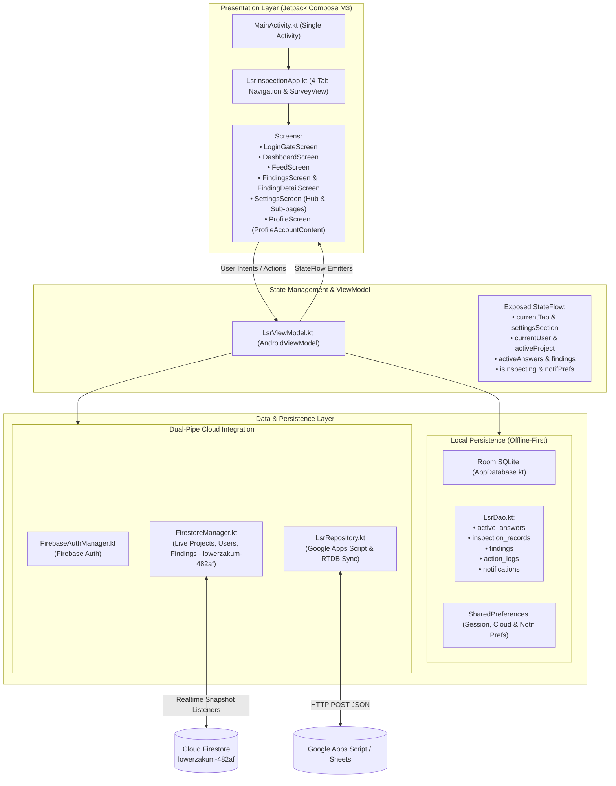
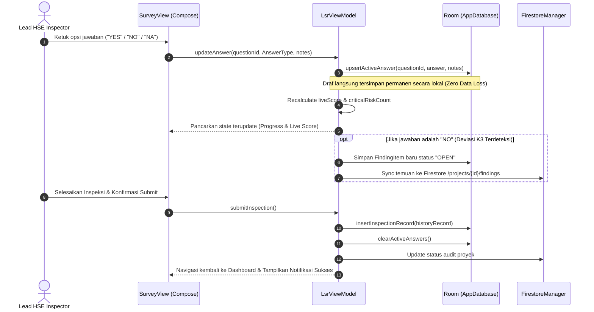

# System Architecture & Technical Design

## Overview
**HSE LSR Inspector** dirancang menggunakan arsitektur modern Android berbasis **Unidirectional Data Flow (UDF)** dengan pola **MVI / MVVM (Model-View-Intent / Model-View-ViewModel)** yang direkomendasikan Google untuk Jetpack Compose.

Arsitektur ini memisahkan secara ketat tanggung jawab antara **Presentasi Deklaratif**, **Manajemen State Terpusat**, dan **Lapisan Data Dual-Pipeline (Lokal & Cloud)**.

---

## 1. High-Level Architecture Diagram

---

## 2. Layer Responsibilities & Contracts

### 2.1 Presentation Layer (`com.example.ui`)
- **Single-Activity Architecture**: [`MainActivity.kt`](file:///Users/rullyberiandi/StudioProjects/LSR/app/src/main/java/com/example/MainActivity.kt) berfungsi sebagai container utama dengan `enableEdgeToEdge()` dan inisialisasi aman Firebase (`lowerzakum-482af`).
- **Root Screen Shell**: [`LsrInspectionApp.kt`](file:///Users/rullyberiandi/StudioProjects/LSR/app/src/main/java/com/example/ui/LsrInspectionApp.kt) mengelola `Scaffold`, transisi layar `AnimatedContent`, `NavigationBar` 4 tab (`Beranda`, `Aktivitas`, `Temuan`, `Pengaturan`), dan render mode survei aktif (`SurveyView`).
- **Layar Mandiri Terisolasi** (`com.example.ui.screens`):
  - `LoginGateScreen`: Autentikasi Firebase Auth dan pemilihan akun terdaftar Firestore secara real-time.
  - `DashboardScreen`: Header ringkas bebas tumpuk, workspace proyek, KPI, form inspeksi, dan filter modul LSR.
  - `FeedScreen`: Sub-tab Notifikasi & Alert serta Riwayat Audit dengan pencarian ringkas (`SleekSearchFilterBar`) dan multi-filter (`ActivityFilterBottomSheet`: tanggal, pengguna, tipe LSR, perusahaan, lokasi).
  - `FindingsScreen` & `FindingDetailScreen`: Manajemen deviasi K3, penugasan PIC, komunikasi & pengingat push langsung antar pengguna, verifikasi rating, dan audit trail.
  - `SettingsScreen`: Pusat Pengaturan terstruktur (`HUB`, `PROFILE`, `MODULES`, `CLOUD`, `NOTIFICATIONS`, `SUPPORT`, `ABOUT`), pemilih tema (`AppThemeMode`: Sistem/Terang/Gelap), dan dukungan `BackHandler`.
  - `ProfileScreen`: Menyediakan `ProfileAccountContent` untuk manajemen akun Firebase Auth dan profil inspektur.

### 2.2 State Layer (`com.example.ui.LsrViewModel`)
- `LsrViewModel` bertindak sebagai *single source of truth* bagi UI.
- Menggunakan `StateFlow` dan `SharedFlow` untuk memancarkan state yang immutable ke Compose.
- Menangani kalkulasi dinamis (skor kepatuhan, temuan kritis terbuka, progress audit).
- Mengorkestrasi penyimpanan otomatis (*auto-save*) draf inspeksi setiap kali opsi jawaban disentuh.

### 2.3 Data Layer (`com.example.data`)

#### A. Database Lokal (Room v5)
- **`AppDatabase`**: SQLite Database terkelola Room (`version = 5`) dengan `MIGRATION_3_4` dan `MIGRATION_4_5` non-destruktif (`company`, `lsrCategories`, `remoteId`, `senderName`).
- **Entitas & Proyeksi Utama**:
  1. `ActiveAnswer`: Menyimpan status draf aktif per pertanyaan (`questionId`, `answer`, `notes`, `assignedPicName`, `updatedAt`).
  2. `InspectionRecord` & `InspectionSummary`: Menyimpan arsip audit serta proyeksi ringan (*summary projection*) termasuk `company` & `lsrCategories` tanpa beban `answersJson` untuk paginasi dan multi-filter Feed berkecepatan tinggi.
  3. `FindingItem`: Menyimpan data temuan ketidaksesuaian K3 (`projectId`, `company`, `evidencePhotoUri`, `evidencePhotoUrl`, status, PIC, dan kalkulasi SLA otomatis 24 jam Kritis / 72 jam Tinggi).
  4. `AppNotification`: Menyimpan riwayat alert & pesan/pengingat lintas pengguna dengan deduplikasi `remoteId` dan kebijakan retensi otomatis (*auto-purge* notifikasi dibaca > 30 hari).
  5. `CustomChecklistStore`: Menyimpan aturan K3 tambahan yang dibuat oleh pengguna.

#### B. Background Sync, Foto Bukti & Ekspor (`SyncWorker`, `EvidencePhotoHelper`, `ReportExporter`)
- **`SyncWorker` & `DraftReminderWorker`** (WorkManager): Mengirim antrean outbox (`isSynced = 0`) + foto bukti ke Cloud Firestore & Firebase Storage secara otomatis saat jaringan tersedia (*exponential backoff*), serta pengingat draf aktif tiap 12 jam.
- **`LsrMessagingService` & `NotificationHelper`**: Menangani push notification FCM (`lsr_alerts`, `lsr_reminders`) dengan preferensi per-kategori, sinkronisasi FCM token ke `users/{uid}`, dan izin runtime Android 13+.
- **`EvidencePhotoHelper`**: Mengompresi foto bukti lapangan hingga maks. 1280px (~100–200 KB JPEG) dan mengunggahnya ke Firebase Storage (`evidence/{findingId}/`).
- **`ReportExporter`**: Menghasilkan laporan PDF A4 (`PdfDocument`) per inspeksi serta ekspor batch CSV via `FileProvider`.

#### C. Cloud Pipeline 1: Firebase Firestore (`FirestoreManager`)
- Menggunakan `PersistentCacheSettings` (100 MB disk cache) untuk memuat feed secara instan dan menjaga ketahanan offline.
- Menyediakan kolaborasi multi-pengguna dalam workspace proyek dengan *bounded queries* (`users` limit 100, `projects` limit 50):
  - Koleksi `users`: Profil personil K3, role, company, `fcmToken`, dan daftar ID proyek yang diizinkan.
  - Koleksi `projects`: Metadata proyek, statistik pra-agregasi (`totalFindings`, `openFindings`, `closedFindings`), dan anggota tim.
  - Subkoleksi `projects/{id}/findings`: Listener terisolasi khusus proyek aktif (*workspace-scoped*) serta sinkronisasi delta (`updatedAt > lastSync`).
  - Subkoleksi `projects/{id}/notifications`: Saluran notifikasi, tugas PIC, pesan langsung, dan pengingat push antar pengguna (`startScopedNotificationsListener`), didukung konfigurasi indeks komposit di [`firestore.indexes.json`](file:///Users/rullyberiandi/StudioProjects/LSR/firestore.indexes.json) dan prototipe rules di [`firestore.rules`](file:///Users/rullyberiandi/StudioProjects/LSR/firestore.rules).

#### D. Cloud Pipeline 2: Google Apps Script (`LsrRepository`)
- Menyediakan jalur integrasi data inspeksi langsung ke lembar kerja Google Sheets korporat via HTTP REST endpoint.
- Memungkinkan ekspor otomatis laporan audit tanpa memerlukan lisensi backend proprietary.

---

## 3. Data Flow: Alur Eksekusi Inspeksi K3

---

## 4. Keandalan Offline-First & Clean Database (*Resilience Pattern*)
1. **Penyimpanan Lokal Sebagai Prioritas Pertama**: Setiap interaksi inspeksi disimpan ke SQLite Room sebelum dikirim ke jaringan.
2. **Real Cloud State (Zero Dummy Data)**: `FirestoreManager` memulai state `users` dan `projects` sebagai list kosong dan hanya diisi dari snapshot listener Firebase Console (`lowerzakum-482af`). Jika koleksi `projects` kosong saat pengguna masuk, `ensureDefaultWorkspace(...)` membuat workspace awal `Lower Zakum Offshore Operations`.
3. **Optimistic UI Updates**: UI langsung merespons sentuhan pengguna tanpa menunggu latensi jaringan (*zero spinner lag* saat audit).
4. **Strict Localization Parity**: Seluruh teks antarmuka dirujuk melalui `AppStrings.get(key, language)` pada [`AppLanguage.kt`](file:///Users/rullyberiandi/StudioProjects/LSR/app/src/main/java/com/example/data/AppLanguage.kt) untuk menjamin tidak ada raw key (`_`) yang tampil di layar.
