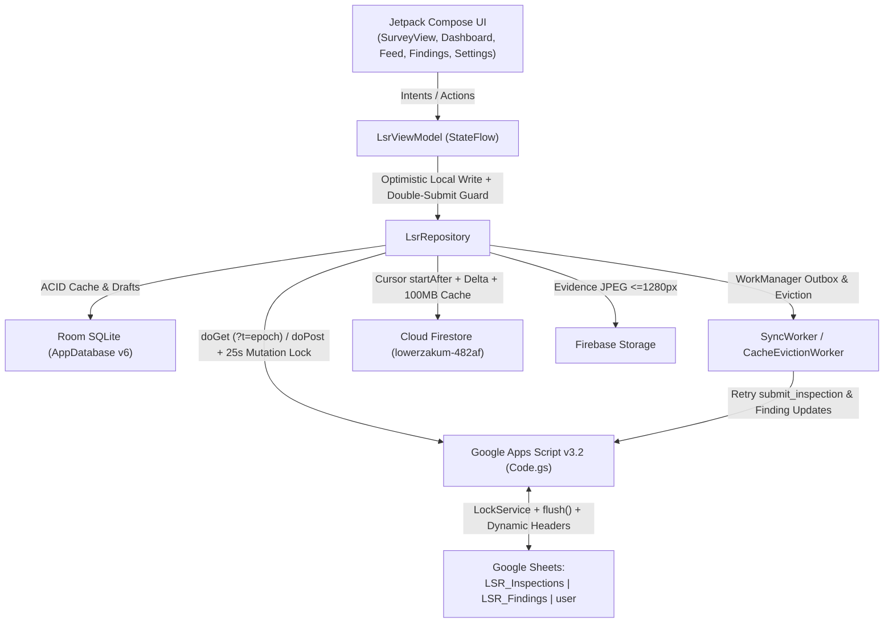

# Architecture & Business Rules (Single Source of Truth)

Dokumen ini menyatukan **status arsitektur sistem terkini**, **skema database & API**, **matriks otorisasi (RBAC + Segregation of Duties)**, serta **daftar roadmap & tech debt** sebagai panduan tunggal pengembangan **HSE LSR Inspector** (`com.lowerzakum.lsr`).

---

## 1. System Snapshot & Tech Stack

| Komponen | Nilai / Standar Terkini |
| :--- | :--- |
| **Application ID** | `com.lowerzakum.lsr` |
| **Firebase Project** | `lowerzakum-482af` |
| **Android SDK / Language** | Min SDK 24, Target/Compile SDK 36, Kotlin `2.2.10`, AGP `9.5.2`, KSP `2.3.6` |
| **UI Layer** | Jetpack Compose M3 (BOM `2024.09.00`), 4 tab utama (`DASHBOARD`, `FEED`, `FINDINGS`, `SETTINGS`) |
| **Local Storage** | Room `2.7.0` (`AppDatabase` **v6**, non-destructive `MIGRATION_3_4`, `MIGRATION_4_5`, `MIGRATION_5_6`) + `SharedPreferences` (dikecualikan dari cloud backup & device transfer) |
| **Cloud Backend 1** | Firebase Auth, Cloud Firestore (100 MB disk cache + cursor `startAfter` + delta `updatedAt`), Firebase Storage, FCM |
| **Cloud Backend 2** | Google Apps Script **`v3.2`** (`Code.gs` <-> `GoogleAppsScriptSnippet.kt`) + Google Sheets |
| **Background Engine** | WorkManager (`SyncWorker`, `DraftReminderWorker`, `CacheEvictionWorker`) + Foreground Polling (`20s` dengan backoff `20s -> 40s -> 80s -> 180s`) |
| **Test Suite** | `ScaleFeaturesUnitTest.kt` — **21 unit tests** |

---

## 2. Arsitektur Aliran Data Dual-Pipeline

### Aturan Sinkronisasi, Pagination & Caching
1. **Offline-First & Zero Data Loss**: Setiap jawaban survei, temuan, dan perubahan status ditulis lebih dulu ke Room v6 sebelum dikirim ke cloud.
2. **Cursor-Based Pagination (Keyset, bukan `OFFSET`)**: Daftar Temuan (`FindingsScreen`) dan Aktivitas (`FeedScreen`) memuat batch `25` item memakai keyset `(timestamp, id)` di Room dan `startAfter(lastVisibleSnapshot)` + `FieldPath.documentId()` di Firestore, dipicu otomatis oleh *prefetching* pada **75% posisi scroll**.
3. **Multi-Layer Smart Cache & TTL**: L1 dibatasi maks. `250` item aktif (`capL1Window`) + `LruCache(200)` detail; L2 Room v6 + Firestore 100 MB di-revalidate via delta `updatedAt` (throttle 30s); `CacheEvictionWorker` berjalan tiap 24 jam untuk memangkas temuan `CLOSED` tersinkronisasi > 7 hari, notifikasi dibaca > 30 hari, dan cache foto > 50 MB (foto temuan aktif/belum sinkron dilindungi).
4. **Rumus Skor Kepatuhan Tunggal**: `LsrRepository.calculateComplianceScore(yesCount, noCount)` menghitung `round((yes * 100.0) / (yes + no))` (mengembalikan `100` jika `yes + no == 0`). Nilai `NA` **tidak** dimasukkan ke penyebut maupun pembilang.
5. **25-Second Mutation Lock**: Mutasi temuan lokal menandai kunci `${timestamp}_${ruleId}_${area}` di `pendingLocalMutations` selama 25 detik agar polling latar belakang dari GAS tidak menimpa perubahan optimistik (*state flicker*).
6. **Full Retry Payload di `SyncWorker`**: Saat `SyncWorker` mengirim ulang `InspectionRecord` yang tertunda (`isSynced = 0`), daftar temuan terkait diambil ulang via `LsrDao.getFindingsByInspectionRecordId(recordId)` sehingga `answers`, `applicableModules`, dan `findings` tetap utuh terkirim ke GAS.

---

## 3. Skema Data & Endpoint Kontrak

### A. Cloud Firestore (`firestore.rules` & `firestore.indexes.json`)
| Path Koleksi | Fungsi | Kebijakan Akses |
| :--- | :--- | :--- |
| `users/{userId}` | Profil personil, `position`, `company`, `fcmToken`, `projectIds` | Read: authenticated; Create/Update: `request.auth.uid == userId` (`aiEnabled` immutable); Delete: `false`. |
| `projects/{projectId}` | Metadata workspace proyek, `ownerUid`, `memberUids`, `roles` | Read: authenticated; Create: `ownerUid == uid`; Update: `ownerUid` / `memberUids`; Delete: `ownerUid`. |
| `projects/{projectId}/inspections/{inspectionId}` | Arsip hasil audit LSR per proyek | Read/Create/Update: `isProjectMember(projectId)`; Delete: `isProjectAdminOrLead(projectId)`. |
| `projects/{projectId}/findings/{findingId}` | Temuan deviasi K3 + status lifecycle + SLA + evidence URL | Read/Create: `isProjectMember`; Update: `isProjectMember` + **SoD (`status != 'CLOSED' || isNotSelfPicClosure()`)**; Delete: `isProjectAdminOrLead`. |
| `projects/{projectId}/findings/{findingId}/action_logs/{logId}` | Jejak audit permanen & komentar langsung | Read/Create: `isProjectMember`; Update/Delete: `false` (*append-only*). |
| `projects/{projectId}/notifications/{notificationId}` | Tugas PIC, chat, dan pengingat push lintas user | Read/Create: `isProjectMember`; Update: hanya field `isRead`; Delete: `false`. |
| `system/config` | Global GAS Webhook URL & toggle sync | Read: `true` (non-PII agar Login Gate dapat bootstrap); Write: **`request.auth.token.admin == true`**. |
| `system/ping` | Verifikasi konektivitas Firestore | Read/Write: authenticated (`keys().hasOnly(['ping', 'user'])`). |

### B. Google Apps Script (`Code.gs` v3.2) & Google Sheets
- **Sheet `LSR_Inspections`**: `Timestamp (ISO)`, `Timestamp (ms)`, `Inspection ID`, `Inspector Name`, `Company`, `Area / Location`, `Compliance Score (%)`, `LSR Categories`, `Total Rules`, `YES`, `NO`, `NA`, `Raw Answers JSON`.
- **Sheet `LSR_Findings`**: `Timestamp (ISO)`, `Timestamp (ms)`, `Finding Key`, `Inspection ID`, `Inspector Name`, `Company`, `Area / Location`, `Rule ID`, `Category`, `Violation Question`, `Standard Reference`, `Severity`, `PIC Name`, `PIC Email`, `Observation Notes`, `Corrective Action`, `Status`, `Rating`, `Updated At (ms)`.
- **Sheet `user`**: `name`, `email`, `role`, `company`, `password` (disimpan sebagai `sha256:...` saat registrasi dari app, **tidak pernah** dikembalikan pada `doGet`, dan **tidak ditimpa** oleh `upsertUserInSheet` untuk user yang sudah ada), `uid`, `created_at`, `updated_at`.
- **Endpoint Actions**:
  - `doGet`: `ping`, `sync_all`, `users`, `setup`.
  - `doPost`: `submit_inspection`, `update_finding`, `register_user`, `login_user`, `sync_user` / `upsert_user`, `setup`.
- **Proteksi Token Opsional (`APP_API_TOKEN`)**: Jika Script Property `APP_API_TOKEN` diset di editor Apps Script, setiap request wajib menyertakan `?token=<secret>` (atau `data.appToken` pada POST).

---

## 4. Aturan Otorisasi & Keamanan Aplikasi

### Matriks RBAC & Segregation of Duties (SoD)
| Aksi | Contractor / Field PIC | Specialist / Supervisor / Inspector | HSSE Operations Lead / Lead HSE Inspector / Admin | Self-Assigned PIC (pada temuan miliknya) |
| :--- | :---: | :---: | :---: | :---: |
| Membuat Inspeksi & Temuan | Ya | Ya | Ya | Ya |
| Mengirim Bukti Perbaikan (`ACTION_SUBMITTED`) | Ya | Ya | Ya | Ya |
| Menugaskan / Mengganti PIC | Tidak | Ya (bukan self-PIC) | Ya (bukan self-PIC) | **Ditolak (SoD)** |
| Verifikasi, Rating & Tutup (`CLOSED`) | Tidak | Ya (bukan self-PIC) | Ya (bukan self-PIC) | **Ditolak (UI + Firestore Rules)** |
| Membuka Kembali (`REOPENED`) | Tidak | Ya (bukan self-PIC) | Ya (bukan self-PIC) | **Ditolak (SoD)** |
| Menghapus Temuan | Tidak | Tidak (Firestore) / Terbatas UI | Ya (`isProjectAdminOrLead`) | **Ditolak (SoD)** |
| Ubah Link GAS & Publish `system/config` | Tidak | Tidak | Admin Password (SHA-256) + Lockout 5x/30s; Firestore tulis butuh `admin == true` | N/A |

### Checklist Pengamanan Klien & Ekspor
- **Autentikasi Ketat**: Login lewat tab `Akun Terdaftar` hanya melakukan autofill email; verifikasi password tetap wajib melalui Firebase Auth atau GAS `login_user`.
- **Proteksi Brute-Force Menu Admin Database**: 5 kali percobaan gagal mengunci input selama **30 detik**.
- **Anti-CSV Injection**: `ReportExporter.csvEscape` menyisipkan apostrof (`'`) di depan nilai berawalan `=`, `+`, `-`, `@`, `\t`, `\r`.
- **Anti-Backup Secret**: `backup_rules.xml` & `data_extraction_rules.xml` mengecualikan `lsr_auth_prefs.xml` dan `lsr_prefs.xml`.
- **Anti-Double Submit**: `LsrViewModel.submitReport()` dilindungi `_isSubmitting` beserta disable tombol dialog konfirmasi.

---

## 5. Next Roadmap & Known Tech Debt

1. **Deployment Cloud Wajib Saat Rilis**:
   - Deploy `Code.gs` v3.2 ke Google Apps Script (**New version**), jalankan `setupSheets()`, dan opsional set Script Property `APP_API_TOKEN`.
   - Di Firebase Console (`lowerzakum-482af`): buat database Firestore `(default)` bila belum aktif, lalu deploy `firestore.rules` dan `firestore.indexes.json`.
   - Berikan Firebase Custom Claim `{ "admin": true }` kepada akun Admin melalui Firebase Admin SDK jika ingin memanfaatkan sinkronisasi global `system/config` ke seluruh perangkat.
2. **Penambahan `storage.rules` untuk Firebase Storage** *(Tech Debt)*:
   - Saat ini repository belum menyertakan file `storage.rules`. Sebelum peluncuran produksi penuh, tambahkan aturan Firebase Storage untuk membatasi path `evidence/**` hanya bagi pengguna terautentikasi dengan batas ukuran file (mis. `<= 5 MB`) dan tipe `image/*`.
3. **Isolasi PII `users/{userId}` untuk Skala Publik** *(Tech Debt)*:
   - Saat ini `users` mengizinkan `allow read: if isAuthenticated()` untuk direktori pemilihan PIC. Jika proyek berkembang lintas organisasi/tenant, pisahkan koleksi publik ringan (`user_directory` tanpa data sensitif) dan batasi `users/{userId}` ke pemilik atau anggota proyek yang sama.
4. **Instrumented & Roborazzi UI Verification**:
   - Tambahkan instrumented test Compose untuk alur `LoginGateScreen` dan verifikasi dialog `SubmitConfirmationDialog` pada perangkat/emulator Android target.
